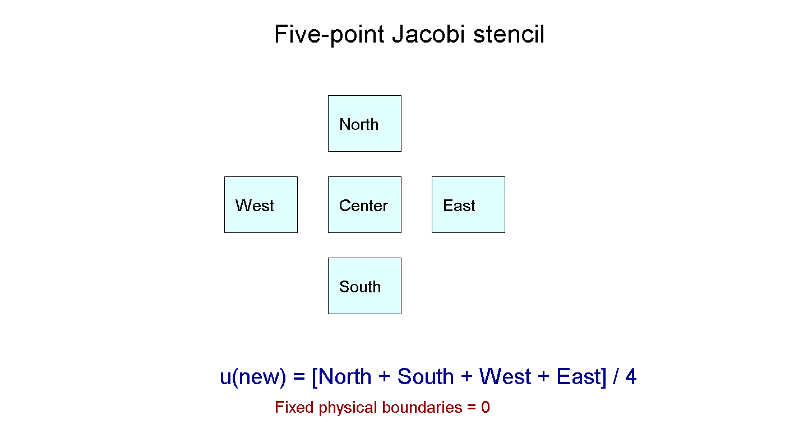
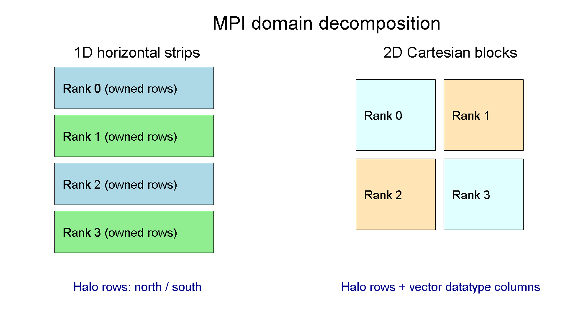
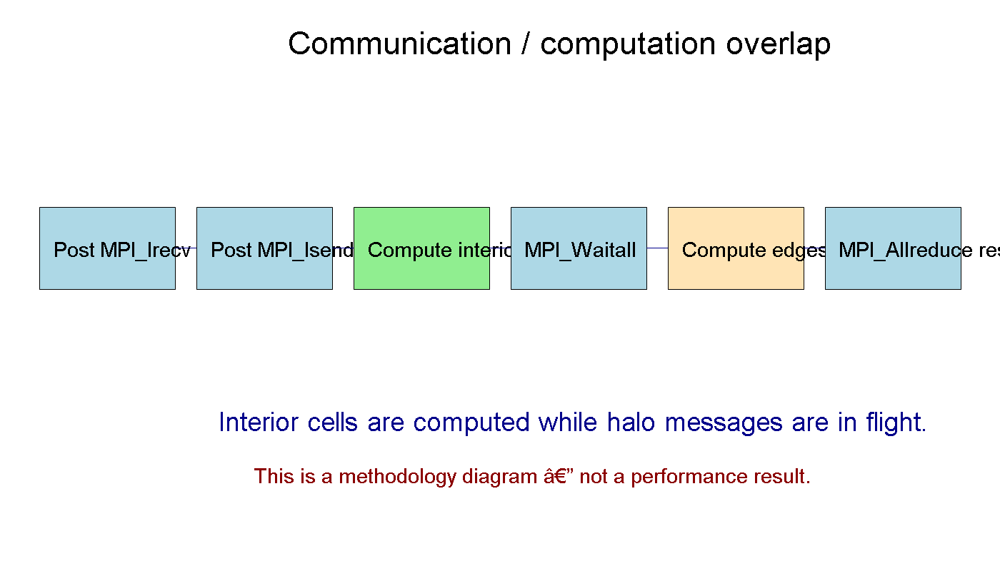
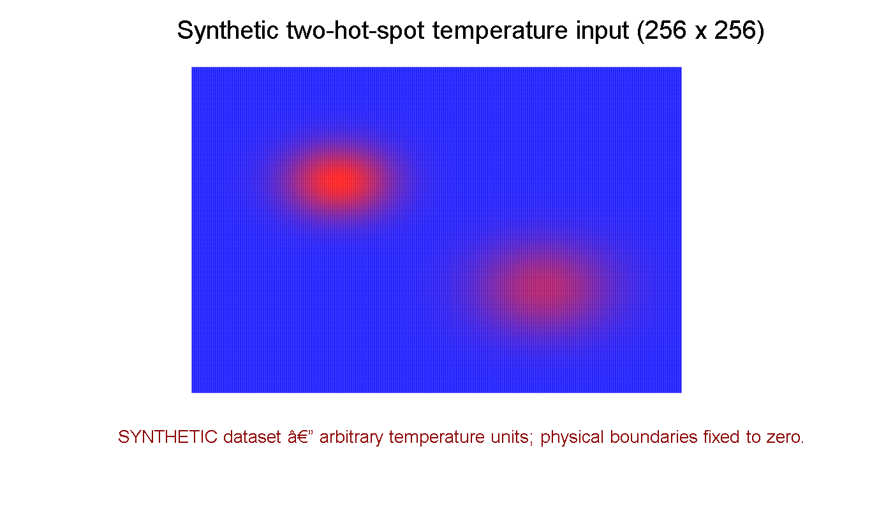

# MPI Stencil with Cartesian Topology

A C11 and MPI implementation of a double-precision 2-D five-point Jacobi stencil. The project compares 1-D horizontal-strip decomposition with 2-D Cartesian domain decomposition and studies halo communication, computation overlap, residual-check cost, strong scaling, and weak scaling.

## Features

- Five-point Jacobi stencil with double-precision values.
- Fixed zero physical boundary conditions.
- Two grid buffers: previous iteration and next iteration.
- Deterministic synthetic temperature input datasets.
- 1-D horizontal strip decomposition.
- 2-D Cartesian decomposition using `MPI_Dims_create`, `MPI_Cart_create`, and `MPI_Cart_shift`.
- Blocking halo communication using `MPI_Sendrecv`.
- Non-blocking halo communication using `MPI_Irecv`, `MPI_Isend`, and `MPI_Waitall`.
- Overlap of communication with interior stencil computation.
- `MPI_Type_vector` for non-contiguous east-west column exchange.
- Global residual calculation using `MPI_Allreduce` with `MPI_MAX`.
- Configurable residual interval through `--check-every`.
- CSV output for timing and experiment measurements.
- Dataset generation, tests, experiment scripts, plots, report material, and document-ready figures.

## Mathematical Model

For each non-boundary grid cell, the Jacobi update is:

\[
u_{i,j}^{new} =
\frac{
u_{i-1,j}^{old} +
u_{i+1,j}^{old} +
u_{i,j-1}^{old} +
u_{i,j+1}^{old}
}{4}
\]

The residual is the maximum absolute update:

\[
R = \max_{i,j}|u_{i,j}^{new}-u_{i,j}^{old}|
\]

Physical boundaries remain fixed at zero.



## Domain Decomposition

### 1-D Strip Decomposition

The global grid is divided into horizontal strips. Each process owns a contiguous set of rows and stores an additional halo row above and below its local grid.

### 2-D Cartesian Decomposition

The global grid is divided into rectangular blocks. Every process discovers its north, south, east, and west neighbours through the Cartesian communicator.



## Halo Exchange and Overlap

Blocking mode exchanges halo values before computing the local stencil.

Overlap mode follows this sequence:

1. Post receives using `MPI_Irecv`.
2. Post sends using `MPI_Isend`.
3. Compute interior cells that do not require incoming halo data.
4. Complete communication using `MPI_Waitall`.
5. Compute edge cells that depend on received halos.
6. Perform residual reduction when required.



## Synthetic Dataset

The project includes deterministic **synthetic** temperature-distribution datasets. These datasets are not real-world temperature measurements.

The temperature field contains two Gaussian hot spots:

\[
T(x,y)=
100e^{-((x-0.30)^2+(y-0.35)^2)/0.012}
+
65e^{-((x-0.72)^2+(y-0.68)^2)/0.020}
\]

All four physical boundaries are fixed to zero.

Available datasets:

| Dataset | Grid Size | Use |
|---|---:|---|
| `dataset/synthetic_temperature_32x32.csv` | 32 × 32 | Tests and correctness checks |
| `dataset/synthetic_temperature_256x256.csv` | 256 × 256 | Strong scaling and overlap experiments |
| `dataset/synthetic_temperature_512x512.csv` | 512 × 512 | Larger runs and weak scaling |



Generate a custom dataset:

```bash
python3 dataset/generate_dataset.py \
  --nx 256 \
  --ny 256 \
  --output dataset/custom_256x256.csv
